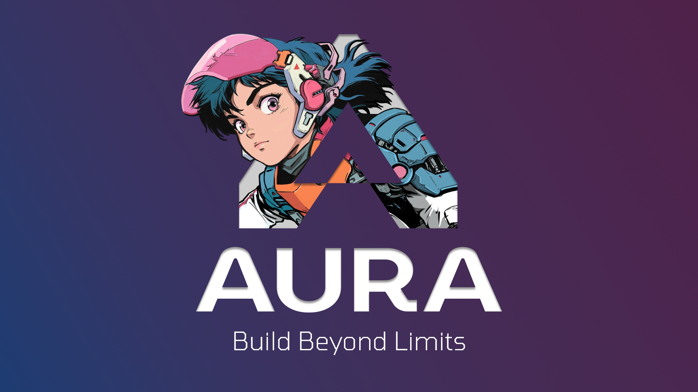

# Aura Autopilot

> By the developers of Aura, [www.tryaura.dev](https://www.tryaura.dev/)

Autopilot is a continually learning real-time general playtesting system. Autopilot learns your game, explores your levels, and improves its gameplay run after run.

Docs: https://www.tryaura.dev/documentation/autopilot

Official Discord: https://discord.gg/tryaura

## Installation

The installation (and uninstallation) instructions in this README are relevant for the Autopilot plugin and for using the Autopilot MCP through Claude Code and Codex. If you are using Autopilot through Aura, no additional setup beyond the Aura setup is necessary. If you are interested in contributing to Autopilot, follow the instructions in [CONTRIBUTING.md](CONTRIBUTING.md).

### Step 1: Download

Download the latest Autopilot build for your game engine and OS from [tryaura.dev/autopilot](https://www.tryaura.dev/autopilot/). We currently support Unreal Engine 5, Unity 6, and Godot 4 on both Windows and macOS.

For advanced Unreal Engine users on Windows, we also support installing Autopilot from source and building it against your own Unreal Engine source build. Select the **Unreal source build** option in [tryaura.dev/autopilot](https://www.tryaura.dev/autopilot/). If you install Autopilot from source, you can skip to **Step 3: Onboarding**.

### Step 2A: Adding to your project (Unreal Engine)

Follow these instructions if your project is on Unreal Engine installed from the launcher.

> If you are using a custom Unreal Engine source build and have run the installation from [tryaura.dev/autopilot](https://www.tryaura.dev/autopilot/), you may skip this step and go straight to **Step 3: Onboarding**. If you don't know whether you are using a custom Unreal Engine source build, you are most likely not using one, which means that you should follow the instructions in this section to add Autopilot to your project.

Autopilot has builds for Unreal Engine 5.4, 5.5, 5.6, 5.7, and 5.8. If you haven't already, download them from [tryaura.dev/autopilot](https://www.tryaura.dev/autopilot/). For Windows users, you should see an `Autopilot-Unreal5.x-Win64.zip` in your downloads folder. For macOS users, you should see an `Autopilot-Unreal5.x-Mac.dmg` in your downloads folder.

1. Extract/open the downloaded `Autopilot-Unreal5.x-Win64.zip` (Windows) or `Autopilot-Unreal5.x-Mac.dmg` (macOS). It contains an `Autopilot/` folder.
2. Move `Autopilot/` into your project's `Plugins/` folder. If your project doesn't have a `Plugins/` folder, create one yourself. If you complete this step successfully, you should have `<YourProject>/Plugins/Autopilot/Autopilot.uplugin`.
3. At this point, it is safe to delete the downloaded zip (Windows) or eject the disk image and delete the downloaded dmg (macOS).
4. Proceed to **Step 3: Onboarding**.

### Step 2B: Adding to your project (Unity)

Follow these instructions if your project is on Unity.

Autopilot has a build for Unity 6 (v6000.0 or later). If you haven't already, download it from [tryaura.dev/autopilot](https://www.tryaura.dev/autopilot/). You should see an `Autopilot-Unity.zip` in your downloads folder.

1. Extract the downloaded `Autopilot-Unity.zip`. It contains `com.ramenvr.autopilot-<version>.tgz`.
2. Open your project in Unity.
3. Go to **Window > Package Management > Package Manager**.
4. Click the **+** icon.
5. Click **Install package from tarball...** and select `com.ramenvr.autopilot-<version>.tgz`.
6. Proceed to **Step 3: Onboarding**.

### Step 2C: Adding to your project (Godot)

Follow these instructions if your project is on Godot.

Autopilot has a build for Godot 4 (v4.7 or later). If you haven't already, download it from [tryaura.dev/autopilot](https://www.tryaura.dev/autopilot/). You should see an `Autopilot-Godot.zip` in your downloads folder.

1. Extract the downloaded `Autopilot-Godot.zip`. It contains an `addons/autopilot/` folder.
2. Move `autopilot/` into your project's `addons/` folder. If your project doesn't have an `addons/` folder, create one yourself, or move `addons/autopilot/` directly into your project folder. If you complete this step successfully, you should have `<YourProject>/addons/autopilot/...`.
3. At this point, it is safe to delete the downloaded zip.
4. Open your project in Godot.
5. Enable Autopilot in **Project > Project Settings > Plugins**.
6. Proceed to **Step 3: Onboarding**.

### Step 3: Onboarding

The Autopilot onboarding flow installs the agent service and sets up the models (LLMs and decision models) for Autopilot to work.

1. Open the Autopilot window. For Unreal and Godot users, click the Autopilot icon (orange controller). For Unity users, click **Window > Autopilot**.
2. We recommend using Autopilot with your Aura account so you can track your usage in one centralized platform. Click **Create Account** if you don't yet have an Aura account, or **Sign in** if you are a returning user. You also have the option to BYOK.
3. Wait for Autopilot to set up and start the agent service. Once it is done, you are automatically redirected to the signup/signin page.
4. Complete the signup/signin process. If you are a new user (signup), confirm your email and then sign in to your Aura account through the Autopilot window.
5. Upon successful authentication, you should see "Signed in as <your_email>" in the Autopilot window. Click **Continue**.
6. You should see "Agent service ready". Click **Continue**.
7. You have the option to enable/disable sharing your runs to improve Autopilot. As the developers of Autopilot, we would of course appreciate your enabling this! Once you are happy with your choice, click **Finish**.
8. If you haven't used Autopilot in your project before (or have emptied your Autopilot project memory), you have the option to run a 10-minute exploration run to populate your Autopilot project memory. **Autopilot visibly improves the more it plays your game**. It is safe to skip this and jump straight to sending your own prompt.
9. Prompt Autopilot! See the types of prompts you can try in [Things to Know](#usage).

## With Coding Agents

You can use Autopilot through Claude Code and/or Codex via our MCP server.

1. Complete all [installation steps](#installation). Signing in with your Aura account allows this to work out of the box; Aura will only count your decision model usage, which means that your LLM usage is counted against your own Claude and/or ChatGPT subscription and not against Aura. If you want to BYOK, you need to provide a [TypeSafe API key](https://console.typesafe.ai/keys).
2. To run the one-time setup, run `autopilot connect claude` for Claude Code or `autopilot connect codex` for Codex.
3. Open Claude Code / Codex and prompt it to "Use Autopilot to ...".

## Things to Know

An Autopilot prompt is one of 4 types:

- **Exploration**, e.g. "Explore the crafting system in Lvl_Main."
- **Testing**, e.g. "Go through the currently open level and tell me everything that looks wrong."
- **Verification**, e.g. "Verify that the tree shakes when you hit it with an axe."
- **Goal**, "Kill the boss while keeping your health above 20% of its maximum value."

For every prompt, Autopilot will automatically launch a PIE window and start reading your project's source code, probe PIE, and start playing according to your prompt. Autopilot plays by using an LLM coding agent to craft harnesses for a decision model according to what it knows about your game, and requests decisions (action choices) from the decision model during gameplay. Once Autopilot is done, the PIE window will close automatically, and Autopilot generates a report for you.

Your first few runs allow Autopilot to learn about your game as it gradually populates its memory. Expect some suboptimal behavior for the first few harness attempts. **Autopilot visibly improves the more it plays your game**, and later harness attempts and runs both take a shorter time to complete a given task, as well as exhibit more intelligent behavior (e.g. faster dodging, equipping better weapons, playing smarter strategies, better aiming).

## Uninstallation

To do a clean uninstall of Autopilot, do the following steps:

1. In Autopilot, go to **Settings** and click **Uninstall**. By default, Autopilot keeps your project's memories; you can choose to delete memories instead (this is a destructive action).
2. Remove the plugin from each project:
   - **Unreal**: Close the editor and delete `Plugins/Autopilot/`.
   - **Unity**: Remove the Autopilot package in the Package Manager.
   - **Godot**: Disable Autopilot in **Project > Project Settings > Plugins**, then delete `addons/autopilot/`.

## Contributing

Contributions are welcome. [CONTRIBUTING.md](CONTRIBUTING.md) explains how to set up a development environment, run the tests, and add support for a new engine. Please follow the [Code of Conduct](CODE_OF_CONDUCT.md).

## License

[Apache License 2.0](LICENSE). The plugins bundle fonts under the SIL Open Font License; see each font's `OFL` file.
